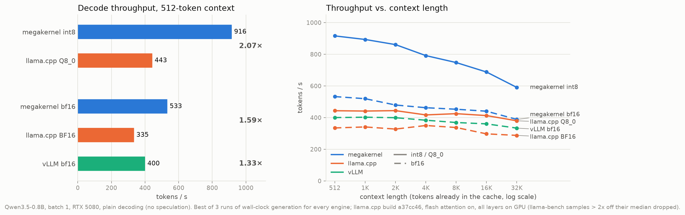

# megakernels

Whole-model decode steps written as a single persistent CUDA kernel: every layer, the LM head and
sampling run inside one launch, with no per-op kernel boundaries and no grid-wide barriers.
Each model gets its own directory with the kernel, a Python runtime, tests and benchmarks.

| Model | Hardware | Result | Directory |
|---|---|---|---|
| Qwen3.5-0.8B (Gated DeltaNet + attention hybrid) | RTX 5080 (sm_120) | **955 tok/s** int8, **555 tok/s** bf16; 2.1× / 1.6× llama.cpp Q8_0 / BF16, 1.33× vLLM bf16; **1205 tok/s** int8 with MTP speculative decoding | [`qwen3.5-0.8b/`](qwen3.5-0.8b/) |



## Why a megakernel

Batch-1 decoding reads every weight once per token and does almost no arithmetic with it, so the
speed limit is DRAM bandwidth. A conventional engine launches hundreds of small kernels per token,
and each boundary drains the GPU and refills it. A megakernel keeps one CTA resident on every SM
for the whole step, streams weights through a TMA ring owned by a producer warp, and hands results
from one op to the next through flags embedded in the data itself. The Qwen kernel sustains 94% of
the bandwidth the card can actually deliver.

Start with [`qwen3.5-0.8b/README.md`](qwen3.5-0.8b/README.md) for the design, measurements and an
optimization log.

## Layout

```
common/                 code shared across models (bandwidth roofline microbenchmark)
qwen3.5-0.8b/           one self-contained project per model
  csrc/                   the kernel and PyTorch binding
  <package>/              Python runtime: weights, engine, chat CLI, OpenAI-compatible server
  bench/  tools/          benchmarks, per-SM timeline profiler, perplexity, plots
  tests/  results/  docs/
docs/adding-a-model.md  how to add the next model
```

Each model directory is installable on its own (`pip install -e qwen3.5-0.8b`) and ships its own
console scripts, so models never depend on each other.

## Quick start

```bash
git clone git@github.com:SamuelReeder/megakernels.git && cd megakernels
pip install -e "qwen3.5-0.8b[dev]"
qwen-mk-chat                    # chat with Qwen3.5-0.8B through the megakernel
qwen-mk-serve --port 8000       # OpenAI-compatible server
cd qwen3.5-0.8b && pytest tests/
```

Requirements: an RTX 50-series GPU (sm_120a), CUDA 12.8+ with `nvcc`, PyTorch 2.8+.

## Adding a model

See [`docs/adding-a-model.md`](docs/adding-a-model.md) for the directory template, the checklist
(reference decoder, correctness tests, bandwidth-checked benchmarks) and the pitfalls found on the
way.

## License

MIT. See [`LICENSE`](LICENSE).
