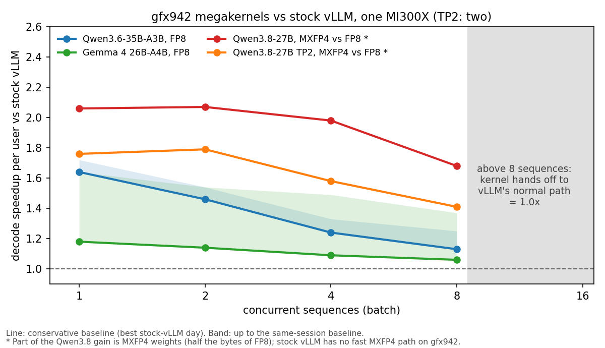

# Decode megakernels on MI300X: results and viability

*November 2026 · Samuel Reeder · code, logs and design docs: [SamuelReeder/megakernels](https://github.com/SamuelReeder/megakernels)*

## TL;DR

**Verdict: a clear gain for low-latency serving at small batch; the relative speedup shrinks as the batch grows.**

- I wrote decode megakernels for three current models on MI300X (gfx942). One persistent GPU launch runs
  every layer of a decode step, and the kernels run inside vLLM on my branches.
- **With the same FP8 weights on both sides, each user gets tokens 1.18-1.64x faster at batch 1 and
  1.06-1.13x faster at batch 8** than with stock vLLM on the same GPU. Batches above 8 are untested.
- The kernel's own weight copy cuts vLLM's KV-cache space by 18-25 %, and each model needs its own kernel.
- The third model, Qwen3.8-27B, uses MXFP4 weights, which have no like-for-like stock baseline on gfx942. Its
  results are in the [supplementary comparison](#supplementary-qwen38-27b-mxfp4).

## What a megakernel changes

A normal engine launches hundreds of small kernels for each generated token. At small batch, the GPU spends
much of the step between kernels instead of reading weights. A megakernel keeps one workgroup resident on each
of the 304 compute units for the whole step. It streams every weight once and passes data from one stage to the
next through grid barriers inside the launch. AMD's ATOM and aitermk megakernels target MI355X. vLLM main already
runs a DeepSeek-V4.1 decode megakernel on MI300X (TP4).

## Results: same weights on both sides

| Model | Weights | Batch 1, per user | Speedup vs stock vLLM, batch 1 / 2 / 4 / 8 | In vLLM, kernel on, batch 1 |
|---|---|---|---|---|
| [Qwen3.6-35B-A3B](https://github.com/SamuelReeder/megakernels/blob/4ebfb50dc45305a8889b614a7b05cc0b978f5b53/qwen3.6-35b-a3b-gfx942/README.md) (MoE) | FP8 | 3.11 ms, 322 tok/s | **1.64 / 1.46 / 1.24 / 1.13x** (same session: 1.72 / 1.54 / 1.33 / 1.25x) | 2.9-3.2 ms |
| [Gemma 4 26B-A4B](https://github.com/SamuelReeder/megakernels/blob/4ebfb50dc45305a8889b614a7b05cc0b978f5b53/gemma4-26b-a4b-gfx942/README.md) (MoE) | FP8 | 3.74 ms, 267 tok/s | **1.18 / 1.14 / 1.09 / 1.06x** (same session: 1.64 / 1.54 / 1.49 / 1.37x) | 3.67 ms |

Bold: against the fastest stock-vLLM run I recorded. Stock vLLM's speed varied by 4-38 % between days on the
same node, so the ratio against the vLLM run in the same session is shown beside it.

**Correctness** (the checks are described in [Method](#method)):
- Perplexity is no more than 1 % above a reference with the same weights (Gemma's is lower). Qwen3.6 scores
  1.589, against 1.585 for the FP8 reference and 1.584 for BF16.
- Inside vLLM, greedy output follows vLLM's own path until the first near-tied token. I have not run a
  task-level evaluation.
- Every kernel passed the determinism and batch-invariance checks.

## How the gain changes with batch size

For every model, the relative speedup is lower at batch 8 than at batch 1. There are three reasons:

- **Fixed savings:** the megakernel removes a mostly fixed cost per step (launches and the gaps between kernels).
  That cost is a large share of a batch-1 step and a smaller share of a batch-8 step.
- **Bandwidth-bound growth:** the work that grows with the batch is bandwidth-bound in both engines, so the
  megakernel cannot make it cheaper. In the MoE models, more requests select more distinct experts: Gemma reads
  about 8 experts per layer at batch 1 and about 33 at batch 8.
- **Small-batch design:** the kernels were designed for small batches, and some of their own costs grow with
  the batch: partial-sum hand-offs, routing, and on-chip memory, which is near its limit at batch 8. From
  batch 1 to 8 the Qwen3.6 kernel's step grows by 3.49 ms, against 2.90 ms for vLLM in the same session.

**Not yet measured:**
- Batches above 8. The kernels are not built for them; inside vLLM those steps run on vLLM's own path.
- Mixed traffic. Any step that includes a new prompt (prefill) also runs on vLLM's path, so under real
  traffic the gain is smaller than in the table.
- Time to first token. Prefill runs on vLLM's path, so it should not change.

**KV cache:** capacity is 18-25 % lower (Qwen3.6, Gemma), because the kernel keeps its own copy of the
weights. This lowers the possible peak batch and context length.

**Headroom:** the kernels are not at the hardware limit. At batch 1 a Gemma layer streams about 100 MB of
weights, which takes about 23 µs at 4.3 TB/s, but the layer takes about 100 µs. The fixed cost of each stage
(barrier, prologue, partial-sum hand-off) dominates in Qwen3.6 too.

## Method

**How each kernel was built.**
1. **Reference:** I wrote a PyTorch reference of one decode step and checked it against HF transformers.
   Qwen3.6 matches at logits cosine 1.000000 and 100 % top-1; Gemma at cosine 0.99942 and 99.9 % top-1.
2. **Kernel:** I wrote the kernel in FlyDSL as one persistent launch: one workgroup per compute unit, with
   stages separated by grid barriers.
3. **Gates:** every change had to pass four checks before I kept it:
   - each layer's output against the reference at batch 1, 2, 4 and 8;
   - three runs bitwise equal;
   - a row gives the same bits alone or in a batch;
   - teacher-forced perplexity on five text passages.

   A change that failed a check was reverted. Each kept or rejected optimization is in the model's
   `docs/DESIGN.md` with its measurement.
4. **vLLM integration:** a DecodeSpec on vLLM PR [#61311](https://github.com/vllm-project/vllm/pull/61311),
   checked by greedy output with the kernel on and off.

Most of the coding was agent-driven, and I reviewed each milestone before the next one started.

**How results were collected.**

| Side | Harness | Measurement |
|---|---|---|
| Kernel (both models) | `bench/bench_decode.py`: the prompt is fed through the kernel, then 256 decode steps are timed with CUDA events | Median of 3 runs |
| vLLM, Qwen3.6 | `vllm bench serve` (0.32.1rc1 nightly, FP8 + AITER): random 512-token prompts, 256 output tokens, 8 × batch requests | Median TPOT over the requests |
| vLLM, Gemma | `bench/vllm_e2e.py`: offline vLLM on the same real-text prompts as the kernel; TPOT = (time for 256 tokens − time for 1) / 255 | Median of 3 runs |

**What was held equal on both sides:**
- **Hardware:** the same MI300X node (`banff-cyxtera-s70-4`), the whole GPU (SPX mode), one GPU.
- **Weights:** the same FP8 checkpoint.
- **Workload:** 512-token prompts, 256 output tokens, batch 1, 2, 4 and 8.
- **Metric:** time per output token in decode.

**Remaining caveats.**
- **Harness (Qwen3.6):** the baseline uses `vllm bench serve`, which adds HTTP and scheduler time. A
  same-harness run inside vLLM, with the kernel on and off, gives larger ratios (1.93x at batch 1), so the
  headline is the conservative comparison.
- **One GPU type:** the headline numbers are from MI300X only. Earlier kernel versions repeated on an MI325X
  and on a second day; the current Qwen3.6 and Gemma kernels were checked on one node.

## Tradeoffs to weigh

1. **One kernel per model.**
   - Each model has about 1,800-2,200 lines of device code, or 2,400-2,700 with weight packing and the host
     runner. A PyTorch reference and the vLLM integration come on top.
   - Qwen3.6 and Gemma took 1-2 days each by adapting the earlier kernels. Qwen3.8 TP2 took 3 days. The shared
     parts now live in one common library.
   - New checkpoint formats or new vLLM cache layouts need kernel work.
2. **Strict deployment needs.**
   - The kernel must have every compute unit to itself. A partitioned GPU, or other work on the same GPU,
     can make it hang.
   - The hipDNN route refuses a launch when the GPU's CU count or occupancy does not fit (unit-tested, not
     yet tried on a partitioned GPU). The direct vLLM route has no such check.
   - Each model needs one binary per batch width (1, 2, 4, 8) for each GPU model, KV layout and TP size
     (Gemma and TP2 also for each max_model_len).
   - The tuning is for gfx942; MI355X would need a port.
3. **Upstream dependency.** Both routes in the next section wait on PRs that are not merged.

## How the kernels reach vLLM

There are two routes. I tested both end to end on MI300X, and they give the same output bits.

| Route | How it works | Status |
|---|---|---|
| **vLLM direct** | A per-model DecodeSpec in vLLM compiles the kernel with FlyDSL at startup and launches it | Works on my vLLM branches; waits on vLLM [#61311](https://github.com/vllm-project/vllm/pull/61311). After that, each model needs its own upstream PR. |
| **Through hipDNN** | The same DecodeSpec calls a hipDNN custom op. A hipDNN engine matches a precompiled code object and launches it, with no compiler at run time. | Speed within 0.8 % of the direct route. The engine, behind a default-OFF flag, is ready for review. The vLLM bridge waits on [ROCm/rocm-libraries#14255](https://github.com/ROCm/rocm-libraries/pull/14255). The binaries need an upload to hipDNN's DVC store. |

Either way, each model keeps its own vLLM-side code: step checks, cache binding and weight packing.

## Supplementary: Qwen3.8-27B (MXFP4)

**Why it is separate.** The [Qwen3.8 kernel](https://github.com/SamuelReeder/megakernels/blob/4ebfb50dc45305a8889b614a7b05cc0b978f5b53/qwen3.8-27b-gfx942/README.md) runs the MXFP4 checkpoint
(`amd/Qwen3.8-27B-Quark-AWQ-MXFP4`), and I did not build an FP8 version of it. Stock vLLM has no fair MXFP4
baseline on gfx942, because the GPU has no native MXFP4: vLLM emulates it (`EmulationMxfp4LinearKernel`). Each
available comparison is therefore biased:

| Batch | Kernel, MXFP4 | vLLM FP8 + AITER (fastest stock option) | vLLM MXFP4, emulated (same weights) |
|---:|---:|---:|---:|
| 1 GPU, batch 1 | 7.56 ms | 15.59 ms (**2.06x**) | 43.03 ms (5.69x) |
| 1 GPU, batch 8 | 10.26 ms | 17.21 ms (**1.68x**) | 44.69 ms (4.36x) |
| 2 GPUs (TP2), batch 1 | 5.59 ms | 9.82 ms (**1.76x**) | 24.78 ms (4.20x, separate session) |
| 2 GPUs (TP2), batch 8 | 7.91 ms | 11.15 ms (**1.41x**) | 25.80 ms (2.97x, separate session) |

**How to read it.**
- **Against FP8 (bold):** the fastest stock option. It overstates the kernel alone: MXFP4 reads about half the
  weight bytes of FP8, and decode at small batch is bandwidth-bound, so part of the gain is the format.
- **Against emulated MXFP4:** the weights are the same, but this measures vLLM's slow fallback, not a real
  option. It overstates the kernel much more.
- **Quality cost:** the kernel on MXFP4 has 4.9 % higher perplexity than the BF16 model (1.658 against 1.581).
  Most of that is the checkpoint: the MXFP4 reference scores 1.645, and the kernel's FP8 activations add 0.8 %.
- **Harnesses:**
  - 1 GPU: `vllm bench serve` 0.29.1, measured on 10-22 on the same node as the kernel.
  - TP2: `vllm bench latency` 0.32 nightly, the engine-level time on both sides, measured on 10-28.
  - TP2 emulated MXFP4: measured in an earlier session, when the kernel took 5.90 ms at batch 1 and 8.69 ms at
    batch 8. Its ratios use those kernel times.
- **What TP2 shows on its own:** splitting the kernel over two GPUs, with the all-reduce inside the kernel, is
  23-28 % faster than one GPU. Both ranks hold bitwise-equal results at every step.
- **Headroom:** barriers and hand-offs take about 40 % of a Qwen3.8 step, and its weight stream reaches
  3.3-3.7 TB/s of the GPU's 5.3 TB/s.

## Links

- Per-model results, every run and log: [Qwen3.6](https://github.com/SamuelReeder/megakernels/blob/4ebfb50dc45305a8889b614a7b05cc0b978f5b53/qwen3.6-35b-a3b-gfx942/README.md) · [Gemma 4](https://github.com/SamuelReeder/megakernels/blob/4ebfb50dc45305a8889b614a7b05cc0b978f5b53/gemma4-26b-a4b-gfx942/README.md) · [Qwen3.8](https://github.com/SamuelReeder/megakernels/blob/4ebfb50dc45305a8889b614a7b05cc0b978f5b53/qwen3.8-27b-gfx942/README.md) · [Qwen3.8 TP2 design](https://github.com/SamuelReeder/megakernels/blob/4ebfb50dc45305a8889b614a7b05cc0b978f5b53/qwen3.8-27b-gfx942/docs/DESIGN-TP2.md)
- hipDNN distribution route (design and results): [docs/hipdnn-route.md](https://github.com/SamuelReeder/megakernels/blob/4ebfb50dc45305a8889b614a7b05cc0b978f5b53/docs/hipdnn-route.md)
- Chart data and sources: [docs/report/plot_speedup.py](https://github.com/SamuelReeder/megakernels/blob/4ebfb50dc45305a8889b614a7b05cc0b978f5b53/docs/report/plot_speedup.py)
