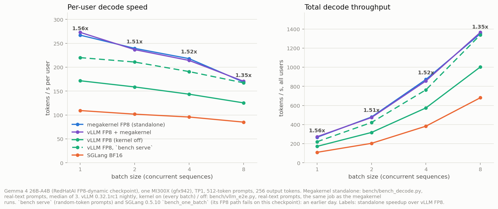
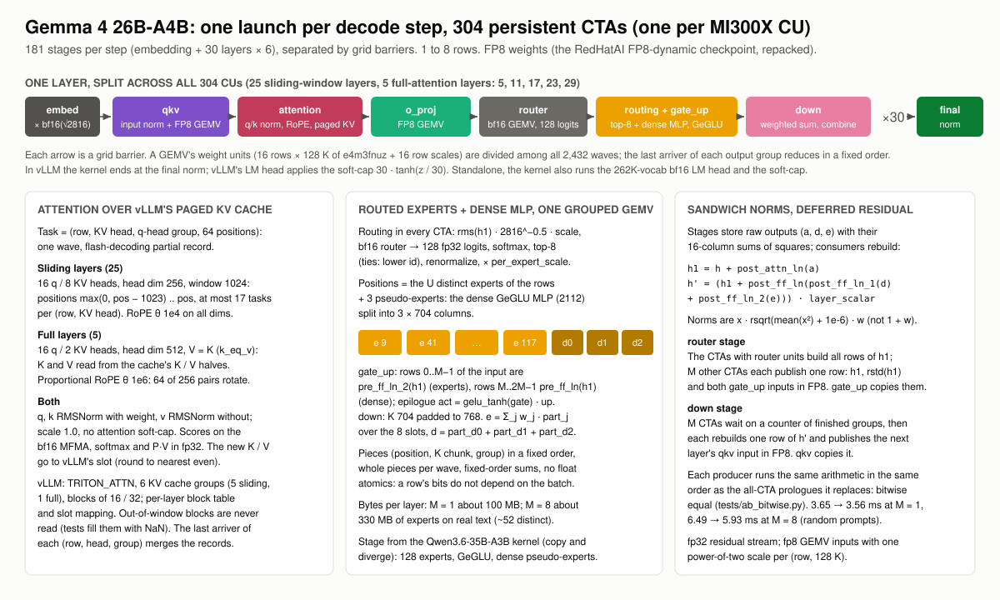
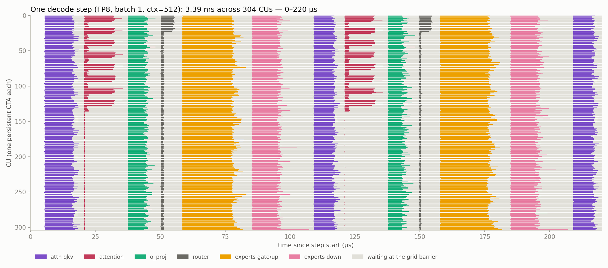

# gemma4-26b-a4b-gfx942 megakernel

The entire decode step of **Gemma 4 26B-A4B** (FP8 checkpoint) in a single persistent
FlyDSL kernel on an AMD **MI300X (gfx942)**. The embedding, all 30 layers (25
sliding-window and 5 full-attention layers, the 128-expert top-8 MoE beside a dense GeGLU
MLP, the sandwich norms) and the final norm run inside one launch per step, for 1 to 8
sequences. The kernel reads and writes vLLM's paged KV cache in place.

On one MI300X, TP1, 512-token prompts of real text, 256 output tokens:

- **Batch 1: 3.58 ms per token, 279 tok/s**, against 4.43 ms (226 tok/s) for vLLM's own
  path on the same GPU and the same prompts: **1.24x**. Batch 2: **1.16x**.
- **Batch 4 and 8: slower than vLLM** (0.95x, 0.92x). At batch 8 the expert weights of
  about 52 distinct experts per layer dominate, and vLLM's fused MoE reads them faster.
  Inside vLLM the kernel therefore serves batch 1 and 2 only.
- **Inside vLLM** (vllm#61311 specialized decode): 3.59 ms at batch 1 and 4.23 ms at
  batch 2, against 4.43 and 4.85 ms with the kernel off.
- **FP8 weights** (`RedHatAI/gemma-4-26B-A4B-it-FP8-dynamic`, one scale per output row)
  with fp8 activations: perplexity on five passages 216.2 against 226.8 for the same
  weights with fp32 activations and 242.7 for the BF16 checkpoint.
- **Bitwise deterministic** and batch-invariant: a row gives the same bits alone or in a
  batch of 2, 4 or 8, with or without padding rows. No float atomics.



## Results

| Batch | vLLM FP8, kernel off | vLLM FP8 + megakernel | vLLM FP8, `bench serve` | SGLang BF16 | Megakernel FP8 | Speedup | Total tok/s |
|---:|---:|---:|---:|---:|---:|---:|---:|
| 1 | 4.43 ms | **3.59 ms** | 4.54 ms | 9.16 ms | **3.58 ms** | **1.24x** | 279 |
| 2 | 4.85 ms | **4.23 ms** | 4.74 ms | 9.83 ms | **4.18 ms** | **1.16x** | 478 |
| 4 | 5.02 ms | 5.01 ms (vLLM's path) | 5.24 ms | 10.45 ms | 5.29 ms | 0.95x | 756 |
| 8 | 6.22 ms | 6.16 ms (vLLM's path) | 5.98 ms | 11.76 ms | 6.77 ms | 0.92x | 1182 |

Time per output token on banff-cyxtera-s70-4 (MI300X), 2026-10-28.

- Megakernel: `bench/bench_decode.py`, real-text prompts, median of 3 runs
  (`bench/results/m7/bench_text_m*.txt`). Speedup: against vLLM FP8 with the kernel off.
- vLLM 0.32.1rc1 nightly, kernel off and on: `bench/vllm_e2e.py`, the same real-text
  prompts (`bench/results/m6/off4.json`, `on4.json`, `compare4.txt`).
- `vllm bench serve` (random-token prompts) and SGLang 0.5.10 `bench_one_batch`:
  `bench/results/stock/summary.md`. SGLang's FP8 path fails on this checkpoint
  (`This GEMM is not supported!`); vLLM + AITER fails on FP8 (no GELU_TANH in its FP8 MoE),
  and without AITER's MoE it is slower than vLLM's default (5.06 ms at batch 1).
- Random-token prompts route to fewer distinct experts: the megakernel takes 3.56 / 4.06 /
  4.80 / 5.93 ms with them (`bench/results/m4/suite/bench_m*.txt`).

Quality (`bench/results/m2/` to `m4/`): the PyTorch reference (`mk/reference.py`) matches
HF transformers in fp32 at logits cosine 0.99942 (worst position) and top-1 99.9 % over a
1300-token prompt (`bench/results/m2/ref_vs_hf_fp32.txt`). The kernel against the
reference at M = 1, 2, 4, 8 and contexts 512, 2048 and 4096 (past the 1024 window): all
pass (`bench/results/m4/suite/test_decode_*.txt`). Determinism: three runs bitwise
equal at M = 1 and 8 over 1100 steps.

Second node (`bench/results/m5/quanta-ccs-aus-j02-45_68199254/`): every test passes on an
MI325X, with the same perplexities as on the MI300X; TPOT 3.45 / 4.03 / 5.03 / 6.45 ms at
batch 1 / 2 / 4 / 8. Second day on the day-1 MI300X
(`bench/results/m5/banff-cyxtera-s70-4_68198890_day2/`): every test passes, TPOT within
0.6 % of day 1 (random-token prompts, as in `bench/results/m4/suite/`).

## How it works



- **One CTA per CU**, 512 threads, all resident. The embedding is one stage; every layer
  is six (qkv, attention, o_proj, router, routing + gate_up, down), separated by grid
  barriers: 181 per step. Each GEMV's weight units are divided among all 2,432 waves.
- **Attention** runs as wave tasks of (row, KV head, q-head group, 64 positions) over
  vLLM's paged cache: q/k RMSNorm, RoPE (full rotation at θ 1e4 for the sliding layers,
  proportional 64-pair rotation at θ 1e6 for the full layers), scores on the bf16 MFMA,
  partial softmax records merged by the last arriver. Sliding layers read only the last
  1024 positions; full layers use V = K (`attention_k_eq_v`).
- **MoE + dense MLP.** Every CTA computes the top-8 routing of all rows (softmax over 128
  fp32 logits, renormalized, times `per_expert_scale`). One grouped FP8 GEMV streams each
  selected expert once, and the dense 2112-wide GeGLU MLP rides along as three 704-wide
  pseudo-experts. The stage comes from the Qwen3.6-35B-A3B kernel (copy and diverge).
- **Deferred residual.** Gemma's sandwich norms need whole rows after every projection.
  Stages store raw outputs with their sums of squares; consumers rebuild h1 and h. A few
  CTAs publish each rebuilt row in FP8 for the next stage (`router_publish`,
  `combine_rows`), bitwise equal to every CTA computing it.
- **FP8.** A unit is 16 rows x 128 K of e4m3fnuz (the checkpoint's e4m3fn bits) plus 16
  fp32 row scales, packed in the order the waves stream it.

The design record, the numerics, the invariants, the decisions with their evidence and the
optimization log are in [`docs/DESIGN.md`](docs/DESIGN.md).

## Where the time goes



Each row is one CU; colored bars are a stage's work, grey is waiting at the grid barrier
for the slowest CU. At batch 1 the 180 layer stages take about 3.1 ms and the LM head
0.29 ms (`bench/results/m7/profile_m1.txt`). A layer streams about 100 MB of weights (about
23 us at 4.3 TB/s) but takes about 100 us: the fixed cost per stage (barrier, prologue,
partial hand-off) and the attention task's serial load chain dominate. At batch 8 the
expert stages take 71 us (gate_up) and 65 us (down) per layer
(`bench/results/m7/profile_m8.txt`). Whole step: [`docs/timeline_m1.png`](docs/timeline_m1.png).

## vLLM integration

Branch [`users/sareeder/gemma4-gfx942-specialized-decode`](https://github.com/SamuelReeder/vllm/tree/users/sareeder/gemma4-gfx942-specialized-decode)
(stacked on the Qwen3.6 branch and vllm#61311) adds a DecodeSpec for this model. The
kernel reads vLLM's KV cache in place (TRITON_ATTN, 6 KV cache groups: 5 sliding-window
groups with 16-token blocks, 1 full group with 32-token blocks) and returns the normed
hidden states; vLLM keeps prefill, the LM head with the logit soft-cap, and sampling.

- Conformance: the Gemma 4 spec tests and the #61311 kit pass (75 tests,
  `bench/results/m6/pytest.txt`).
- Greedy outputs with the kernel on follow vLLM's own path until a near-tie: every first
  divergence is at a logprob gap of 1.25 or less, including two prompts of about 2440
  tokens (past the window). vLLM's own path at batch 8 and at batch 1 diverges as often
  (`bench/results/m6/compare4.txt`, `compare_off_b8_b1.txt`).
- The kernel keeps its own repacked copy of the weights: 24.4 GiB, which reduces vLLM's
  KV cache by 18 % (`bench/results/m6/memory.txt`).

## Quick start (Alola cluster)

```bash
salloc -p miopen -A miopen -J g4dev --constraint="GFX942&MARKHAM" --gres=gpu:1 \
       --cpus-per-task=16 --mem=200G -t 12:00:00 --no-shell
# models in ~/mk/models: gemma-4-26B-A4B-it (BF16) and gemma-4-26B-A4B-it-FP8-dynamic
scripts/mkrun 'python tests/test_decode.py $G4/gemma-4-26B-A4B-it-FP8-dynamic 1 30 16 2048'
scripts/mkrun 'python bench/bench_decode.py $G4/gemma-4-26B-A4B-it-FP8-dynamic 1 512 256 3'
```

`scripts/mkrun '<command>'` ships this directory to the held allocation (the job named
`g4dev`, or `MK_JOB=<jobid>`) and runs the command in the hipdnn gfx942 image with the venv
of `qwen3.8-27b-gfx942/scripts/setup_env.sh` (torch + ROCm, FlyDSL 0.4.0).

## Repository layout

```
mk/kernel.py       the kernel: stage sequence, grid barriers, Cfg (every compile-time setting)
mk/gemv.py         the split-K FP8 / bf16 GEMV stream (one scale per row)
mk/moe.py          routing, the grouped expert GEMV, the expert epilogues
mk/attention.py    attention tasks over the paged KV cache and the record merge
mk/stages.py       GEMV prologues and epilogues, row rebuilds and publishers
mk/dev.py, dims.py device helpers (barrier, DPP reductions), model dimensions
mk/pack.py         FP8 checkpoint -> unit-order tiles
mk/runner.py       host engine: buffers, pointer tables, one launch per step
mk/reference.py    PyTorch reference of the decode step (exact, emulating and fp32 modes)
tests/             kernel vs reference, attention stage, determinism, perplexity, vs HF
bench/             decode benchmark, per-stage profiler, stock baselines, vLLM harnesses
tools/             plots: throughput chart, per-CU timeline
scripts/           cluster runner, reproducibility job, vLLM export
```

## Tests and benchmarks

```bash
bash tests/run_suite.sh $MODELS OUT_DIR       # everything, about 1.5 h on one MI300X
python bench/profile_decode.py $MODELS/gemma-4-26B-A4B-it-FP8-dynamic 1 512 timeline.json
python tools/timeline.py timeline.json docs/timeline_m1_zoom.png --zoom 0 220
python tools/plot_results.py 'bench/results/m7/bench_text_m{b}.txt' \
       bench/results/m6/on4.json bench/results/m6/off4.json
```

## Limits

- Decode only: the prompt goes in one token per step outside vLLM; in vLLM, vLLM runs
  prefill. Greedy argmax outside the kernel.
- One GPU (TP1), 1 to 8 rows, gfx942 (MI300X) only. FP8 checkpoint only.
- Slower than vLLM at batch 4 and 8 on real text; vLLM serves those batches itself.
- Text only: no vision or audio inputs.
- The kernel's weight copy costs 24.4 GiB inside vLLM.
