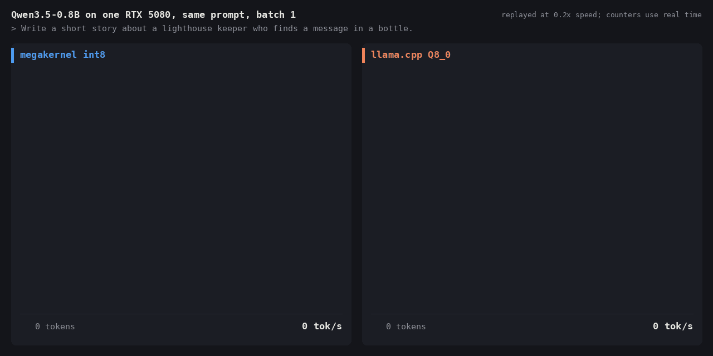
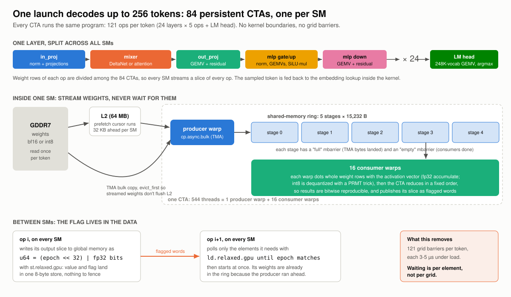
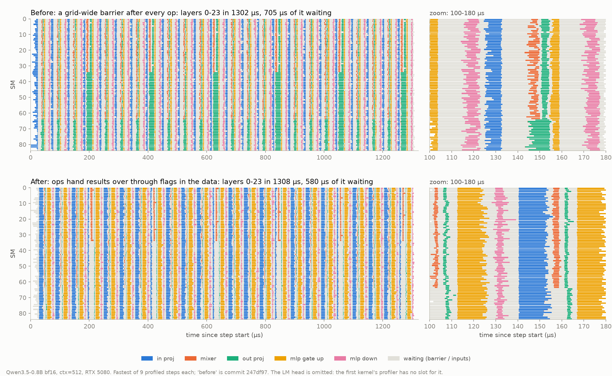
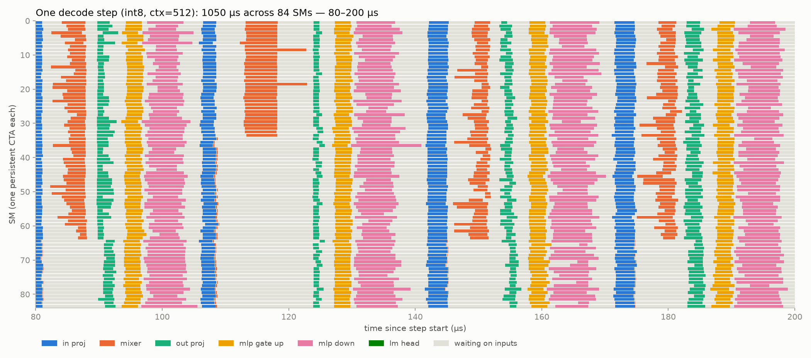

# qwen3.5-0.8b megakernel

The entire decode step of **Qwen3.5-0.8B** in a single persistent CUDA kernel. All 24 layers
(18 Gated DeltaNet + 6 gated attention), the 248K-vocab LM head and sampling run inside one
launch, and the kernel feeds each sampled token back to itself for up to 256 tokens per launch.

On an RTX 5080 at batch size 1:

- **bf16: 555 tok/s**, streaming weights at **857 GB/s**, which is 94% of the 915 GB/s the card
  actually sustains in a pure bandwidth test.
- **int8 (Q8_0-style): 955 tok/s.** WikiText-2 perplexity rises from 17.141 to 17.161 (+0.12%).
- **Speculative decoding with the model's own MTP head: 1205 tok/s int8 (1.25×) and 745 tok/s bf16
  (1.37×)** on chat replies, with output identical to plain decoding, token for token.
- **1.6× and 2.1× faster than llama.cpp** BF16 and Q8_0 (current master, flash attention, every
  layer on the GPU), and **1.33× faster than vLLM 0.32** in bf16 (CUDA graphs), comparing wall-clock
  against wall-clock without speculation. At a 32K-token context the margins are 1.35×, 1.56× and
  1.16×.
- **Bitwise deterministic**, and it matches Hugging Face transformers (perplexity 17.1408 against
  17.1402, and within 0.15% over a 32K-token window).
- It runs as an interactive chat CLI or as an OpenAI-compatible server, with tool calling, streaming
  and state reuse across turns.




The clip replays a real recording (`tools/demo_record.py`) of both engines streaming the same prompt
through their own streaming paths, slowed to 0.2× so it is watchable; the counters use real time.

## Quick start

Requirements: an RTX 50-series GPU (sm_120; developed and measured on an RTX 5080), a CUDA
toolkit with `nvcc`, and PyTorch built for CUDA 12.8 or later.

```bash
pip install -e .            # torch, transformers, safetensors, ninja
qwen-mk-chat                # streaming chat in the terminal (int8 by default; --quant bf16)
qwen-mk-serve --port 8000   # OpenAI-compatible API at http://127.0.0.1:8000/v1
```

The first run downloads the model from Hugging Face and JIT-compiles the kernel, which takes about
a minute. After that the kernel is cached. In a chat session, replies stream at about 1030 tok/s
(int8, sampled at temperature 0.7, 16 tokens per launch for smooth streaming), or 910 tok/s with
`--no-spec`.

```bash
curl localhost:8000/v1/chat/completions -H 'Content-Type: application/json' \
  -d '{"messages": [{"role": "user", "content": "Explain TMA in one sentence."}], "stream": true}'
```

The server implements `/v1/chat/completions` (streaming and non-streaming), `/v1/models`, tool
calls (translated to and from Qwen's XML tool-call format), and `enable_thinking`. Any
OpenAI-compatible client or agent harness can point at it.

From Python:

```python
from qwen_mk.session import ChatSession

s = ChatSession(quant="int8")
for tok in s.chat([{"role": "user", "content": "Hi!"}], temperature=0.7):
    print(s.tok.decode([tok]), end="", flush=True)
print(s.stats)  # prefill / decode token counts and tok/s
```

`qwen_mk.engine.Megakernel` is the lower-level API. `run(tokens, n_generate, temperature,
stop_ids, ...)` feeds tokens and generates on the GPU in one launch, and `run_spec(token, draft,
n_generate, ...)` does the same speculatively.

## Results

All numbers are from an RTX 5080 (84 SMs, 16 GB GDDR7, 960 GB/s spec) under WSL2. Raw numbers are
in [`results/`](results/), and [`bench/run_all.sh`](bench/run_all.sh) reproduces them. That script
brackets every segment with a raw-bandwidth check and reruns it if anything else touched the GPU.

### Decode throughput

| context | megakernel int8 | llama.cpp Q8_0 | | megakernel bf16 | llama.cpp BF16 | | vLLM 0.32 bf16 | |
|---:|---:|---:|---:|---:|---:|---:|---:|---:|
| 1 | 920 | 432 | 2.13× | 535 | 335 | 1.60× | 396 | 1.35× |
| 512 | 916 | 443 | 2.07× | 533 | 335 | 1.59× | 400 | 1.33× |
| 1024 | 893 | 441 | 2.02× | 519 | 341 | 1.52× | 402 | 1.29× |
| 2048 | 861 | 444 | 1.94× | 479 | 327 | 1.46× | 399 | 1.20× |
| 4096 | 792 | 417 | 1.90× | 462 | 350 | 1.32× | 383 | 1.21× |
| 8K | 748 | 425 | 1.76× | 453 | 337 | 1.34× | 369 | 1.23× |
| 16K | 688 | 413 | 1.67× | 440 | 297 | 1.48× | 360 | 1.22× |
| 32K | 591 | 380 | 1.56× | 388 | 288 | 1.35× | 334 | 1.16× |

The speedup columns compare the megakernel with the engine to their left (the bf16 megakernel for
vLLM, since vLLM runs bf16 here). This table is plain decoding; speculative decoding has its own
section below.

Each figure is tokens/s, best of 3 timed runs of wall-clock generation for every engine. vLLM runs
with CUDA graphs, batch 1 and prefill excluded (`bench/bench_vllm.py`, in its own environment).
Megakernel numbers include the launch gaps and host round trips between 128-token launches.
llama-bench occasionally reports a corrupt repetition (12,000 tok/s, or zero), so its samples more
than 2× off their median are dropped before taking the best. For reference, Hugging Face
transformers manages 26 tok/s on the same GPU (bf16, eager, without the optional
flash-linear-attention kernels).

Every cached position adds 12 KB of reads to each step (6 attention layers, bf16 K and V), so at 32K
the KV cache adds 400 MB per token: half as much again as the int8 weights. Attention is split-K
over up to 42 chunks per KV head, and the bandwidth the kernel sustains (weights, state and KV)
stays at 85–94% of the roofline in bf16 and 79–88% in int8 across the whole range. A 32K-token WikiText-2 window scores within 0.15% of HF transformers'
perplexity in every position band (0–4K, 4K–16K, 16K–32K), so long-range attention is checked as
well as timed.

Measured on the GPU's own clock (the median step time, which excludes launch gaps):

| | ms / token | tok/s | weight + state bytes / token | effective bandwidth |
|---|---:|---:|---:|---:|
| bf16, ctx 1 | 1.801 | 555 | 1.54 GB | 857 GB/s (94% of 915) |
| int8, ctx 1 | 1.047 | 955 | 0.84 GB | 801 GB/s (88% of 915) |

915 GB/s is the best that any access pattern achieved in [`common/bw.cu`](../common/bw.cu)
(plain loads or a TMA ring), so it is the realistic roofline. bf16 sits within 7% of it.

### Quality

| | WikiText-2 perplexity (16 × 1024 tokens) |
|---|---:|
| HF transformers, bf16 | 17.1402 |
| megakernel, bf16 | 17.1408 |
| megakernel, int8 | 17.1608 |

The bf16 kernel is also checked logit by logit against an fp32 PyTorch reference decoder, which
itself matches HF to 5e-4. Max |Δlogit| is 0.045, and argmax agrees at every position. The int8
kernel is checked against the same reference running on the dequantized int8 weights, so kernel
bugs can't hide inside quantization error.

### Optimization log

Every version below was rebuilt from its commit and measured back to back (bf16 wall-clock tok/s,
512-token context):

| commit | change | bf16 | int8 |
|---|---|---:|---:|
| `247df97` | persistent kernel, TMA weight ring, 121 grid barriers per token | 447 | |
| `78bc2b8` | grid barriers replaced by flag-in-data dataflow; L2 prefetch cursor | 479 | |
| `d8da027` | prefetch distance retuned; ring slots sized to int8 rows; int8 mode | 504 | 820 |
| `3ce3eed` | attention latency work (KV prefetch, early loads), fewer register spills | 512 | 841 |
| `9a01f3b` | GEMV inputs swizzled in shared memory (no bank conflicts); speculative decoding | 521 | 883 |

The last row was measured later, back to back with `3ce3eed`'s kernel, which ran at 518 / 869 tok/s
that day (the same machine drifts by a few percent between sessions). It is plain decoding. The
swizzle's effect is clearer on the GPU clock, where the int8 step is 5% faster, and in speculative
cycles, where it is 11% faster (see [Speculative decoding](#speculative-decoding)).
## How it works

### The model

Qwen3.5-0.8B is a hybrid. Three of every four layers are **Gated DeltaNet** linear attention: a
fixed-size 128×128 fp32 state per head, updated with a delta rule, plus a short causal conv. Every
fourth layer is **gated full attention**: 8 query heads, 2 KV heads, head dim 256, partial RoPE,
q/k RMSNorm, and a sigmoid output gate. The hidden size is 1024, the SwiGLU MLP is 3584 wide, and
the 248,320-token LM head is tied to the embeddings.

At batch size 1, every token has to stream all 1.5 GB of bf16 weights from DRAM, so decode speed is
a memory-bandwidth problem. A conventional implementation launches dozens of kernels per layer.
Each launch leaves DRAM idle while it ramps up and drains, and the small ops (norms, the DeltaNet
recurrence, attention for a single query) are pure latency.

### One kernel, one CTA per SM



The kernel runs one 544-thread CTA per SM for the whole generation:

- **A producer warp streams weights.** It walks the exact sequence of weight rows this SM will need
  (every GEMV slice of every layer, then the LM head, step after step) and issues `cp.async.bulk`
  (TMA) copies into a 5-slot shared-memory ring (4 in speculative cycles, whose input vectors
  take twice the space), synchronized with mbarriers. A second cursor
  issues `cp.async.bulk.prefetch.L2` 32 KB further ahead. Weight streaming doesn't depend on any
  activation, so DRAM keeps working while the consumers wait on data dependencies. Weights are
  loaded with an L2 `evict_first` policy so they don't push the recurrent state out of L2.
- **16 consumer warps compute.** Each GEMV is split into contiguous row slices per CTA, and the
  rows of each ring slot are dealt round-robin to warps. Norms, gating and activations are fused
  into GEMV prologues: RMSNorm, gated RMSNorm with `silu(z)`, the attention sigmoid gate. Residual
  adds, SwiGLU and LM-head argmax are fused into epilogues. Each CTA keeps an fp32 master copy of
  the residual rows it owns in shared memory.

### No grid barriers: flag-in-data dataflow

The first version used a grid-wide barrier between dependent ops: 121 per token. In isolation a
barrier costs about 0.5 µs, but under full DRAM load it takes 3–5 µs, because the barrier's
atomics queue behind the weight stream.

The current kernel has none. Every activation is published as a 64-bit word
`(epoch << 32) | fp32 bits`, written with `st.relaxed.gpu`. A consumer spins (`ld.relaxed.gpu` +
`__nanosleep`) on exactly the elements it needs until they carry the expected epoch. Data and
"ready" travel in the same store, so there is no separate flag to order against, no fence, and no
reset. Single buffering is safe because every op consumes all of its predecessor's output before
anyone can overwrite it. Ops that only need part of their input, such as a DeltaNet head waiting on
its own q/k/v rows, start as soon as that part lands. Sampling works the same way: each CTA
publishes its local best `(score, index)` and every CTA reduces all 84 to agree on the next token.



Both timelines are one bf16 decode step at ctx 512 (`tools/before_after.py` profiles the first
commit from git history). Barrier removal changes the shape of the work: with barriers, every SM
sits idle at the end of every op and then all of them restart together; with flags, SMs start an op
as soon as their own inputs land and the ops overlap. How much that buys is in the optimization log
(+7%, together with the L2 prefetch cursor). The time spent inside the 24 layers hardly moved
between these two versions. The rest of the speedup since the first commit came from tuning around
them (prefetch distance, int8, attention).

### The token mixers

- **Gated DeltaNet** runs as 64 tasks: 16 heads × 4 slices of 32 value columns. The recurrent
  state is stored `[head][v][k]`, so each warp's column update is a coalesced 512-byte row, and the
  conv history is an 8-slot ring indexed by position (deep enough to roll back a rejected draft).
- **Attention** is split-K over the KV cache: up to 42 splits per KV head, one task per CTA, with
  an online softmax per warp. The last task to finish (tracked by an atomic counter) merges the
  partials. While the QKV projection is still running, each CTA prefetches its slice of the
  bf16 KV cache into L2.
- **Determinism:** every reduction runs in a fixed order, with no float atomics anywhere, so a
  given prompt and seed produce bitwise-identical logits whether tokens are fed one per launch or
  all in one.

### int8 weights

Each weight row is stored as `K` bytes of `q + 128`, followed by `K/32` bf16 scales (llama.cpp's
Q8_0 scheme: symmetric, one scale per 32 weights). Each row therefore stays one contiguous
16-byte-aligned span that TMA can copy. The inner loop turns bytes into floats with a `PRMT`
magic-number trick (`0x4B000000 | byte` is the float `2^23 + byte`; one subtraction recovers
`q`), avoiding int→float conversions. Ring slots are 15232 bytes, which holds exactly 14, 7 or 4
int8 rows for K = 1024, 2048 or 3584. The kernel is templated on the weight format, and the
embedding lookup stays bf16.

### Generation, stop tokens and chat state

`run()` feeds the prompt one token per step (skipping the LM head until the last prompt token)
and then generates, with sampling done on the GPU by Gumbel-max inside the LM-head epilogue. When
the kernel predicts a stop token, every CTA sees the same token and exits at the same step without
feeding it in. The producer reports how many weight copies are in flight and the consumers drain
them first. As a result, the recurrent state ends exactly after the last real token.

DeltaNet state can't be rolled back, so `ChatSession` snapshots the recurrent state (20 MB)
before each `<|im_start|>assistant` header and resumes from the longest matching snapshot. This
handles chat templates that re-render earlier turns differently. Prompts longer than 256 new
tokens are prefilled through transformers in one batched pass, and the resulting conv, recurrent
and KV state is copied into the kernel's buffers.

## Where the time goes

[`tools/timeline.py`](tools/timeline.py) records `globaltimer` stamps on every SM for every op of
one step and draws them. This is 120 µs of an int8 step at a 512-token context:



Each colored bar is one op on one SM, and gray is time spent waiting for inputs. Each layer is
in_proj → mixer → out_proj → MLP gate/up → MLP down. The attention layer stands out around 120 µs:
the two CTAs that merge the split-K partials extend past everyone else. The full step is
[`docs/timeline_int8.png`](docs/timeline_int8.png).

Over the whole step (1050 µs), the breakdown is:

- **The LM head is 28%** (289 µs). It moves 270 MB at roofline speed, part of it prefetched into
  L2 before the op starts.
- **Dependency latency is the main loss.** Five data dependencies per layer cost 3.2 µs each on
  average, and none of them can be removed: every GEMV needs the whole previous output for its
  norm. The weight stream keeps running underneath, but the ring and the L2 window only hold about
  108 KB per SM, so long waits eventually starve DRAM. Each hop is slow because its loads and
  stores queue behind the saturated weight stream (about 1 µs per round trip).
- **Registers are the binding constraint.** 17 warps per SM cap the kernel at 96 registers per
  thread (five of them share one of the SM's four register files). Batching more KV positions per attention round trip made attention *slower*, because the
  extra registers spilled.

## Speculative decoding

Qwen3.5 ships a multi-token-prediction (MTP) head: one extra decoder layer trained to predict the
token after next. The megakernel uses it as a built-in draft model, inside the same persistent
launch. Chat and the server decode speculatively by default (`--no-spec` turns it off).

**A cycle** at position p feeds two tokens through the 24 layers together: the pending token x_p and
the draft d, a guess for x_{p+1}. Every GEMV dots each weight row with both input vectors, so one
pass over the weights serves two tokens, while DeltaNet and attention step through the two
positions in order. The LM head samples y0 at p and y1 at p+1, exactly as two plain steps would. If
y0 equals the draft, both tokens are emitted. Otherwise only y0 is. Then the MTP head runs on the
main model's final hidden states: `fc([norm(embed(y_j)), norm(h_j)])`, its own gated-attention layer
at positions p and p+1 (with its own KV cache), and a draft head on the last accepted position,
which yields the next cycle's d. That makes 128 ops per cycle, up to 256 cycles per launch.

**The output is exactly plain decoding's.** The acceptance test is the speculative-sampling rule
for a deterministic draft: y0 is a genuine sample from the model, and accepting exactly when it
equals the draft leaves the distribution unchanged. Sampling noise is keyed on (seed, position,
token id), so a cycle draws the very samples plain decoding would, and the output matches token for
token, greedy or sampled. The tests check the ids and also that every logit of a cycle is bitwise
equal (`torch.equal`) to plain decoding's. That needed one non-obvious fix: NVCC contracted
multiply-adds into FMAs differently in the one- and two-token instantiations of the same code, which
moved a few logits by one ulp. The kernel is built with `--fmad=false`, and every FMA is written out
with `fmaf`.

**Rollback.** By the time the draft is checked, it has already been folded into the recurrent
state. DeltaNet state can't be rolled back, so a cycle writes the state after its first token to a
backup and the state after its second token to the main buffer. The next cycle reads whichever one
was accepted, and a launch that ends on a rejection copies the backup over. The conv history is an
8-slot ring indexed by position, and attention KV at a rejected position is simply overwritten.

**Draft vocabulary.** A full-vocabulary draft head reads the whole 248K-row embedding matrix, as many
bytes as the LM head (270 MB in int8), which would eat most of the gain. The draft head instead
scores only the 32K tokens the model itself generates most often (`qwen_mk/draft_vocab.npy`). The
ranking is self-distilled: [`tools/draft_vocab.py`](tools/draft_vocab.py) has the model write 600
requests across 57 topics, 9 kinds of task and 5 languages, answer each one in a fresh chat, and
counts the tokens of the replies. No dataset is involved, and the benchmark prompts play no part.
Acceptance on 16 chat prompts, greedy ([`tools/mtp_acceptance.py`](tools/mtp_acceptance.py)):

| draft vocabulary | acceptance | int8 draft head |
|---:|---:|---:|
| 248,320 (full) | 0.743 | 270 MB |
| 65,536 | 0.731 | 71 MB |
| **32,768** | **0.714** | **36 MB** |
| 16,384 | 0.676 | 18 MB |
| 8,192 | 0.645 | 9 MB |

**Results.** These are the 16 chat prompts, up to 256 greedy tokens each
([`bench/bench_spec.py`](bench/bench_spec.py)), timed on the GPU clock with plain and speculative
runs alternated. Both produce identical tokens.

| | plain tok/s | speculative tok/s | speedup | tokens / cycle | ms / cycle (vs step) |
|---|---:|---:|---:|---:|---:|
| int8, 32K draft vocabulary | 967 | **1205** | **1.25×** | 1.69 | 1.40 (1.03) |
| bf16, 32K draft vocabulary | 546 | **745** | **1.37×** | 1.69 | 2.26 (1.83) |
| int8, full draft vocabulary | 961 | 1029 | 1.07× | 1.72 | 1.66 (1.04) |
| bf16, full draft vocabulary | 550 | 624 | 1.13× | 1.71 | 2.73 (1.81) |

**Where a cycle's time goes.** Counting bytes alone, a cycle should cost about 1.07 plain steps,
since the MTP layer and the 32K draft head add 57 MB to the 840 MB of an int8 step. The first
working version cost 1.43 steps. The per-op profile (`tools/timeline.py --spec`) showed every GEMV
running 1.4–1.9× longer with two tokens than with one, and the two-token LM head never waiting for
weights: the consumers, not DRAM, had become the bottleneck. The cause was shared-memory bank
conflicts. Each lane reads its 16 input floats as four `float4` loads, 64 bytes from its
neighbour's, which puts four lanes of every quarter-warp on the same banks. With one token those
conflicts hid under DRAM latency. With two input vectors per weight row they set the pace. The
kernel now stores every GEMV input vector swizzled (`swz()` XORs each 16-byte unit's position within
its 64-byte group), so each quarter-warp's loads hit eight distinct bank groups:

| int8, ctx 512 | plain step | speculative cycle | two-token LM head |
|---|---:|---:|---:|
| before the swizzle | 1104 µs | 1580 µs (1.43 steps) | 313 µs, 0 µs waiting for weights |
| after | 1050 µs | 1400 µs (1.33 steps) | 290 µs, 173 µs waiting for weights |

The plain step got 5% faster as well. Of the 350 µs a cycle still adds to a step, the MTP layer
takes 57 µs and the draft head 38 µs. Most of the rest is dependency latency: the hand-offs between
ops average 5.1 µs instead of 3.2 µs, and each one now carries two tokens' activations.

## Possible next steps

Two draft tokens per cycle (the MTP head chained on its own output), shorter hand-offs in the
two-token cycle, a 15-warp layout (128 registers per thread), and FP8 or 4-bit weights.

## Repository layout

```
csrc/megakernel.cu     the kernel: producer, GEMV, LL dataflow, DeltaNet, attention, LM head, MTP cycle
csrc/megakernel.h      shapes, parameter structs, tunables
csrc/binding.cpp       PyTorch extension entry points
qwen_mk/engine.py      weight packing (bf16 / int8), state buffers, launch API (plain and speculative)
qwen_mk/mtp.py         the MTP head in PyTorch: draft-cache fill for prompts, oracle for the kernel
qwen_mk/draft_vocab.npy  token ranking for the reduced draft head (tools/draft_vocab.py)
qwen_mk/session.py     chat template, state snapshots, fast prefill
qwen_mk/chat.py        qwen-mk-chat
qwen_mk/server.py      qwen-mk-serve (OpenAI-compatible, stdlib only)
qwen_mk/reference.py   fp32 PyTorch reference decoder (matches HF)
bench/                 decode and speculative benchmarks, bandwidth roofline, barrier microbenchmark, run_all.sh
tools/                 per-SM timeline profiler, before/after comparison, MTP acceptance, draft vocabulary,
                       demo recorder, perplexity, plots
tests/                 kernel vs reference (bf16, int8), determinism, sessions, speculative == plain
```

## Tests and benchmarks

```bash
pytest tests/                                   # 29 tests, ~1 min
python bench/bench_decode.py --quant int8       # tok/s and GB/s at contexts from 1 to 32K
python bench/bench_spec.py --quant int8         # speculative vs plain on chat replies
python tools/timeline.py --quant int8 --ctx 512 --png docs/timeline_int8.png --zoom 80 200
python tools/timeline.py --quant int8 --ctx 512 --spec   # the same for a speculative cycle
python tools/mtp_acceptance.py --draft-vocab 0 32768    # draft acceptance, full vs reduced draft head
python tools/before_after.py                    # grid barriers (first commit) vs flags, per-SM timelines
python tools/perplexity.py                      # WikiText-2, megakernel bf16 / int8 vs HF
python tools/demo_record.py && python tools/demo_render.py   # the side-by-side GIF
bench/run_all.sh && python tools/plot_results.py
```

Notes:
- Under WSL2 the Windows GPU watchdog kills kernels that run longer than about 2 s. Launches are
  therefore capped at 256 steps, and the host loops.
- Shapes are compile-time constants for Qwen3.5-0.8B. Ring depth and slot size can be overridden
  for experiments with `QWEN_MK_DEFINES="-DMK_STAGES=6 -DMK_CHUNK=..."`.
