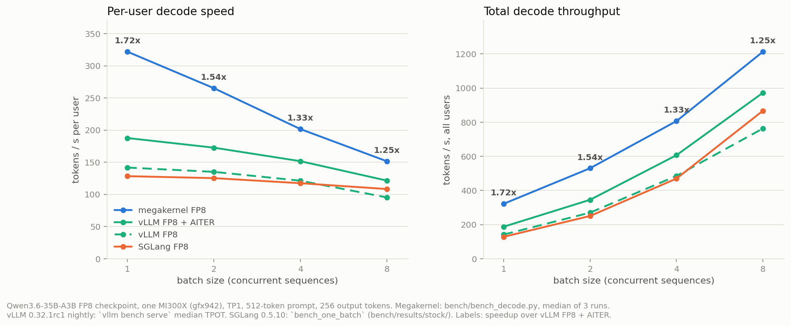
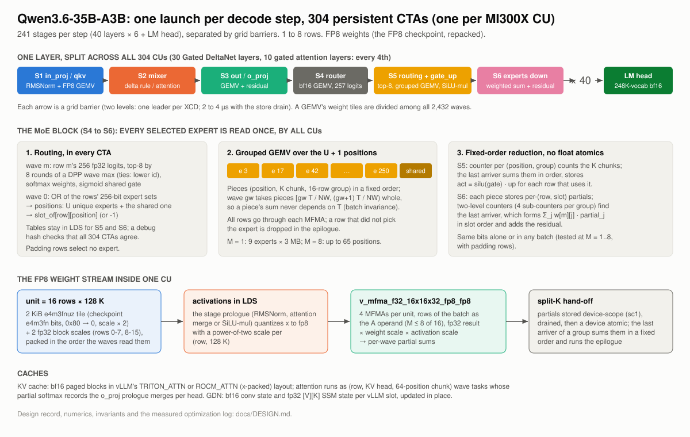
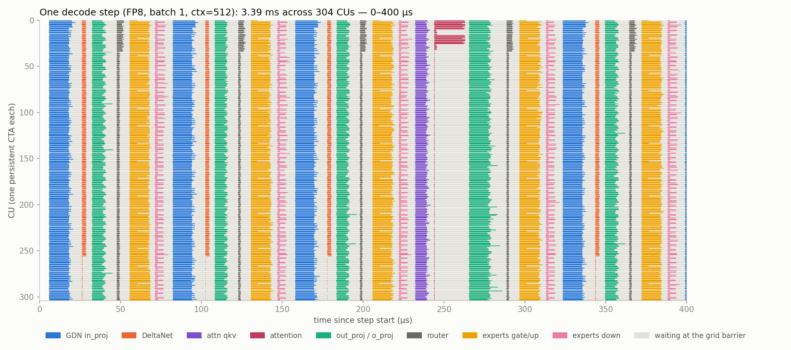

# qwen3.6-35b-a3b-gfx942 megakernel

The entire decode step of **Qwen3.6-35B-A3B** (FP8 checkpoint) in a single persistent
FlyDSL kernel on an AMD **MI300X (gfx942)**. All 40 layers (30 Gated DeltaNet + 10 gated
attention), the 256-expert top-8 MoE with its shared expert, every state and cache
update and the 248K-vocab LM head run inside one launch per step, for 1 to 8 sequences.

On one MI300X, TP1, 512-token context, 256 output tokens:

- **Batch 1: 3.42 ms per token, 292 tok/s**, against 5.11 ms (196 tok/s) for the fastest
  stock engine on the same GPU (vLLM nightly + AITER on the FP8 checkpoint): **1.49x**.
- **Batch 2 / 4 / 8: 1.38x / 1.24x / 1.17x** against the same baseline; 1256 tok/s total
  at batch 8.
- **Inside vLLM** (vllm#61311 specialized decode, kernel reads vLLM's paged KV cache and
  GDN state in place): 3.2 to 3.5 ms at batch 1, 1.2x to 2.1x vLLM's own path.
- **FP8 weights** (`Qwen/Qwen3.6-35B-A3B-FP8`, 128 x 128 block scales) on the gfx942 fp8
  matrix cores, with fp8 activations: perplexity 1.589 against 1.585 for the same
  weights with fp32 activations and 1.584 for BF16.
- **Bitwise deterministic** and batch-invariant: a row gives the same bits alone or in a
  batch of 2, 4 or 8, with or without padding rows. No float atomics.



## Results

| Batch | vLLM FP8 + AITER | vLLM FP8 | SGLang FP8 | Megakernel FP8 | Speedup | Total tok/s |
|---:|---:|---:|---:|---:|---:|---:|
| 1 | 5.11 ms | 6.43 ms | 7.79 ms | **3.42 ms** | **1.49x** | 292 |
| 2 | 5.51 ms | 6.67 ms | 7.98 ms | **3.99 ms** | **1.38x** | 501 |
| 4 | 6.17 ms | 7.20 ms | 8.51 ms | **4.97 ms** | **1.24x** | 804 |
| 8 | 7.44 ms | 8.95 ms | 9.23 ms | **6.37 ms** | **1.17x** | 1256 |

Time per output token on banff-cyxtera-s70-4 (MI300X). Megakernel:
`bench/bench_decode.py`, median of 3 runs (`bench/results/m4/bench_v5_m*.txt`). vLLM
0.32.1rc1 nightly through `vllm bench serve` (scheduler included) and SGLang 0.5.10 with
`bench_one_batch`, on the same node (`bench/results/stock/`, summary in
`bench/results/stock_summary.md`; the BF16 checkpoint is there too: vLLM + AITER 4.93 ms
at batch 1). Speedup: against vLLM FP8 + AITER.

Quality (`bench/results/m3/`): the kernel against the PyTorch reference
(`mk/reference.py`, which matches HF transformers at cosine 1.000000 and top-1 100 %,
`bench/results/m2/ref_vs_hf.txt`) at M = 1, 2, 4, 8 over all 40 layers; teacher-forced
perplexity on five passages: kernel 1.589, FP8 reference 1.585, BF16 1.584.
Second day (`bench/results/m5/banff-cyxtera-s70-4_68196706/`, 2026-10-28, commit
`41443a0`, same node): every test passes, batch-invariant and bitwise deterministic,
perplexity 1.584, TPOT 3.41 / 4.02 / 4.99 / 6.41 ms at batch 1 / 2 / 4 / 8 (within 1 %
of day 1).

Second node (`bench/results/m5/quanta-ccs-aus-j02-45_68197689/`, 2026-10-28, AMD Instinct MI325X on quanta-ccs-aus-j02-45,
commit `41443a0`): every test passes, batch-invariant and bitwise deterministic,
perplexity 1.584, TPOT 3.30 / 3.86 / 4.75 / 5.96 ms at batch 1 / 2 / 4 / 8 (against day 1 on an MI300X: -3.6 % / -3.1 % / -4.5 % / -6.4 %).

One other MI300X (ctr-cx63-mi300x-12) gave non-deterministic results for this kernel and
for the Qwen3.8 kernel. On that GPU the plain PyTorch reference was not reproducible
either; the GPU is faulty, not the kernels (`bench/results/m5/ctr-cx63-mi300x-12_68192231/`).

## How it works



- **One CTA per CU**, 512 threads, all resident. Every layer is six stages separated by
  grid barriers (in_proj / qkv, mixer, out_proj / o_proj, router, routing + expert
  gate_up, expert down); each GEMV's weight tiles are divided among all 2,432 waves.
- **MoE.** Every CTA computes the top-8 routing of all rows from the router logits, and
  builds the same list of the U unique selected experts plus the shared expert. One
  grouped FP8 GEMV streams each selected expert once, whatever the batch; rows that did
  not pick an expert are dropped in the epilogue. Expert outputs are reduced per row
  in slot order with the routing weights: no float atomics.
- **FP8.** A unit is 16 rows x 128 K (a 2 KiB e4m3fnuz tile plus two fp32 block scales),
  packed in the order the waves stream it. `v_mfma_f32_16x16x32_fp8_fp8` multiplies it
  with the fp8 activations the stage prologue wrote to LDS (power-of-two scale per row
  and 128 K).
- **Split-K with a last arriver, or inside the CTA.** in_proj, qkv, out_proj and the
  router give each CTA whole 16-row output groups; its waves sum their partials in LDS
  in a fixed order and one wave runs the epilogue (no global partials, no atomics). The
  other GEMVs store each wave's partial sums; a device-scope counter finds the last wave
  of an output group, which sums the partials in a fixed order and runs the epilogue
  (residual, SiLU-mul, the causal conv of the DeltaNet inputs).
- **Mixers** run as wave tasks: the gated delta rule on a 16 x 128 fp32 slice of the
  state per wave; attention as (row, KV head, 64 positions) chunks whose partial softmax
  records the o_proj prologue merges.

The design record, the numerics, the invariants and the optimization log (what helped
and what did not) are in [`docs/DESIGN.md`](docs/DESIGN.md).

## Where the time goes



Each row is one CU; colored bars are a stage's work, grey is waiting at the grid barrier
for the slowest CU. At batch 1 the 240 layer stages take 3.16 ms (median stage spans
from 2.8 us for the DeltaNet tasks to 20 us for o_proj, plus 2 to 4.5 us per barrier)
and the LM head 0.23 ms (`bench/results/timeline/profile_m1.txt`): the fixed cost per
stage (prologue, partial hand-off, barrier) dominates, not the weight stream. Whole
step: [`docs/timeline_m1.png`](docs/timeline_m1.png). The CTA-local reduction (2026-10-29)
cut this fixed cost: 3.68 -> 3.13 ms at batch 1 and 7.16 -> 6.66 ms at batch 8 against
the previous code in the same hour on the same node (`bench/results/fsc/final/`;
docs/DESIGN.md, "Fixed stage cost"). The timeline images show the previous code.

## vLLM integration

Branch [`users/sareeder/qwen36-gfx942-specialized-decode`](https://github.com/SamuelReeder/vllm/tree/users/sareeder/qwen36-gfx942-specialized-decode)
(stacked on the Qwen3.8 branch and vllm#61311) adds a DecodeSpec for this model. The
kernel reads vLLM's paged KV cache (TRITON_ATTN or ROCM_ATTN layout) and its GDN conv
and SSM state in place, and writes the normed hidden states; vLLM keeps prefill, the LM
head and sampling. TPOT on one MI300X, 512-token prompts, 256 tokens:

| Backend | B = 1 | B = 2 | B = 4 | B = 8 |
|---|---|---|---|---|
| TRITON_ATTN, vLLM | 5.25 ms | 5.22 ms | 6.32 ms | 8.00 ms |
| TRITON_ATTN, kernel | 3.48 ms | 4.10 ms | 4.60 ms | 6.69 ms |
| ROCM_ATTN, vLLM | 6.30 ms | 6.58 ms | 7.09 ms | 8.23 ms |
| ROCM_ATTN, kernel | 3.16 ms | 4.05 ms | 5.07 ms | 6.56 ms |

Round 1 of two (`bench/results/m6/RESULTS.md`). Greedy outputs follow vLLM's own path
until a near-tie (logprob gaps within vLLM's own TRITON-vs-ROCM gaps); the kernel took
every decode step (its device step counter). The kernel keeps its own repacked copy of
the weights: about 32 GiB, which reduces vLLM's KV cache by about 25 %.

## Quick start (Alola cluster)

```bash
sbatch -p defq,miopen -A miopen -J mk36 --constraint="GFX942&MARKHAM" \
       --gres=gpu:gfx942-mi300x:1 --cpus-per-task=16 --mem=400G -t 12:00:00 --wrap "sleep 43200"
# container: /cluster/images/hipdnn/hipdnn_latest_gfx942.sqsh (pyxis), then once:
bash scripts/setup_env.sh                     # venv: torch + rocm, flydsl 0.4.0
python tests/test_decode.py $M/Qwen3.6-35B-A3B-FP8 1 40 32       # kernel vs reference
python bench/bench_decode.py $M/Qwen3.6-35B-A3B-FP8 1 512 256 3  # TPOT, batch 1
```

`scripts/mkrun '<command>'` syncs this directory to the cluster and runs the command in
the held allocation (`MK_JOB=<jobid>`). Request `gpu:gfx942-mi300x`: the constraint
`GFX942&MARKHAM` alone also matches MI300A nodes.

## Repository layout

```
mk/kernel.py       the kernel: stage sequence, grid barriers, Cfg (every compile-time setting)
mk/gemv.py         the split-K FP8 / bf16 GEMV stream
mk/moe.py          routing, the grouped expert GEMV, the expert epilogues
mk/stages.py       GEMV prologues (LDS input) and epilogues
mk/mixer.py        Gated DeltaNet and attention tasks, the attention merge prologue
mk/dev.py, dims.py device helpers (barrier, DPP reductions), model dimensions
mk/pack.py         FP8 checkpoint -> unit-order tiles
mk/runner.py       host engine: buffers, pointer tables, one launch per step
mk/reference.py    PyTorch reference of the decode step (exact and fp8-emulating modes)
tests/             kernel vs reference, determinism, real-text perplexity, reference vs HF
bench/             decode benchmark, per-stage profiler, stock baselines, vLLM harnesses
tools/             plots: throughput chart, per-CU timeline
scripts/           cluster runner, environment, vLLM export, ISA statistics
```

## Tests and benchmarks

```bash
bash tests/run_suite.sh $MODELS OUT_DIR       # everything, about 1.5 h on one MI300X
python bench/profile_decode.py $MODELS/Qwen3.6-35B-A3B-FP8 1 512 timeline.json
python tools/timeline.py timeline.json docs/timeline_m1_zoom.png --zoom 0 400
python tools/plot_results.py 'bench/results/m4/bench_v5_m{b}.txt'
```

## Limits

- Decode only: the prompt goes in one token per step outside vLLM; in vLLM, vLLM runs
  prefill. Greedy argmax outside the kernel.
- One GPU (TP1), 1 to 8 rows, gfx942 (MI300X) only. FP8 checkpoint only; the BF16
  checkpoint and MXFP4 are not built (the weight format sits behind one GEMV interface).
- No MTP or speculative decoding.
- The kernel's weight copy costs about 32 GiB inside vLLM.
- One MI300X (ctr-cx63-mi300x-12) gave non-deterministic results for this kernel and
  for the Qwen3.8 kernel; the cause is not proven
  (`bench/results/m5/ctr-cx63-mi300x-12_68192231/`).
