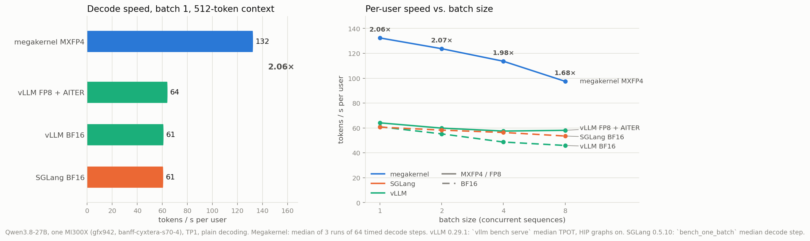
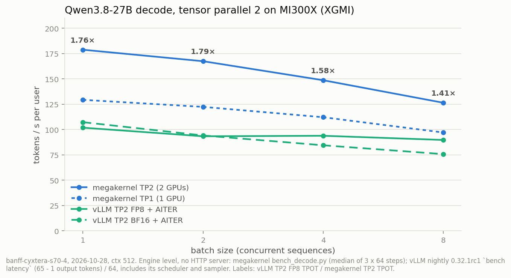
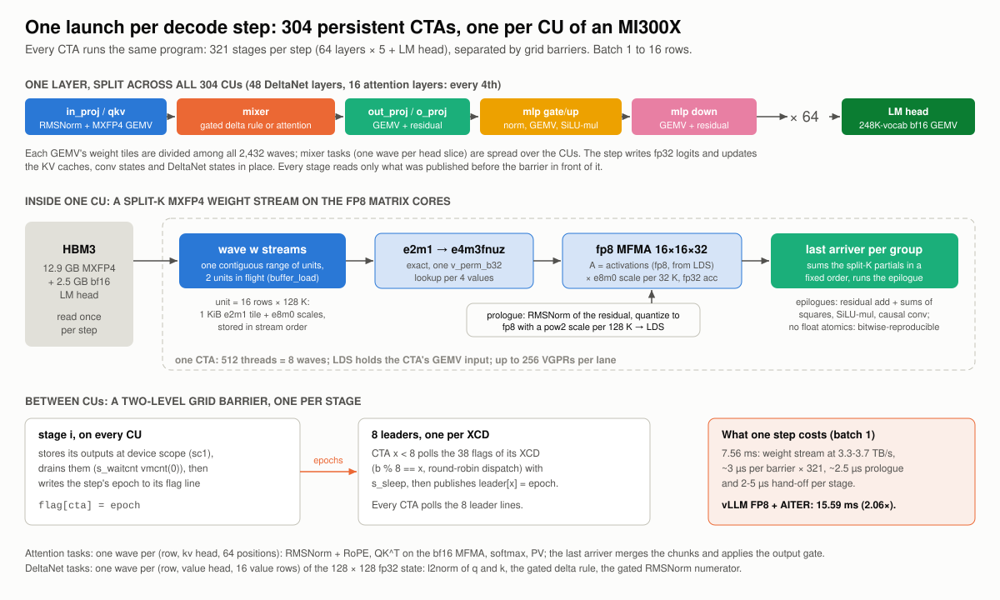
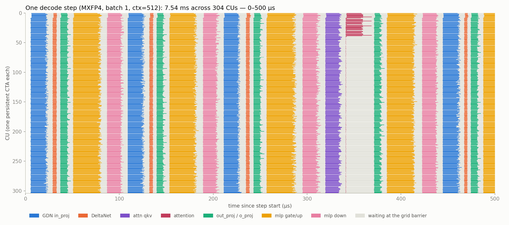

# qwen3.8-27b-gfx942 megakernel

The entire decode step of **Qwen3.8-27B** in a single persistent FlyDSL kernel on an AMD
**MI300X (gfx942)**. All 64 layers (48 Gated DeltaNet + 16 gated attention), every state and
cache update and the 248K-vocab LM head run inside one launch per step, for 1 to 16 sequences.

On one MI300X, TP1, 512-token context:

- **Batch 1: 7.56 ms per token, 132 tok/s**, against 15.59 ms (64 tok/s) for the fastest stock
  engine on the same GPU (vLLM 0.29.1 + AITER on the FP8 checkpoint): **2.06×**.
- **Batch 2 / 4 / 8: 2.07× / 1.98× / 1.68×** per user against the same baseline.
- **MXFP4 weights** (`amd/Qwen3.8-27B-Quark-AWQ-MXFP4`), decoded exactly to fp8 for the gfx942
  fp8 matrix cores (gfx942 has no MX MFMA). The kernel's fp8 activations add 0.8% perplexity
  against the same weights with bf16 activations.
- **Bitwise deterministic** and batch-invariant: no float atomics, split-K sums in a fixed order.
- Reproduced on a second MI300X, on an MI300A (228 CUs) and five days later on the same node.



## Quick start (Alola cluster)

```bash
salloc -p miopen -A miopen -J mkdev --constraint="GFX942&MARKHAM" --gres=gpu:1 \
       --cpus-per-task=16 --mem=200G -t 12:00:00 --no-shell
# container: /cluster/images/hipdnn/hipdnn_latest_gfx942.sqsh (pyxis), then once:
bash scripts/setup_env.sh                     # venv: torch 2.14.1+rocm7.2, flydsl 0.4.0
python tests/test_decode.py $M/Qwen3.8-27B-Quark-AWQ-MXFP4 1 64 16      # kernel vs reference
python bench/bench_decode.py $M/Qwen3.8-27B-Quark-AWQ-MXFP4 1 512 64 3  # TPOT, batch 1
```

`scripts/mkrun '<command>'` syncs this directory to the cluster and runs the command in the
held allocation. Tested on MI300X and MI300A in SPX mode (every CU must hold one resident CTA) with
ROCm 7.2, PyTorch 2.14.1 and FlyDSL 0.4.0.

## Results

| Batch | vLLM FP8 + AITER | SGLang BF16 | Megakernel MXFP4 | Speedup |
|---:|---:|---:|---:|---:|
| 1 | 15.59 ms | 16.48 ms | **7.56 ms** | **2.06×** |
| 2 | 16.71 ms | 17.17 ms | **8.08 ms** | **2.07×** |
| 4 | 17.39 ms | 17.74 ms | **8.80 ms** | **1.98×** |
| 8 | 17.21 ms | 18.69 ms | **10.26 ms** | **1.68×** |

Time per output token, one MI300X (banff-cyxtera-s70-4). The stock engines were measured on
the same GPU; vLLM through `vllm bench serve` (scheduler included), SGLang with
`bench_one_batch`. Context 2048 / 4096: 7.86 / 8.18 ms at batch 1. Every run, the other GPUs,
the quality checks and the failed runs are in [`bench/RESULTS.md`](bench/RESULTS.md); the
stock baselines for every checkpoint and engine are in
[`bench/stock/results.md`](bench/stock/results.md).

## Tensor parallel 2 (two MI300X over XGMI)

The same kernel runs split over two GPUs (`Cfg.tp = 2`, vLLM's TP2 layout): one persistent
launch per GPU and step, and the 128 all-reduces of a step (after out_proj / o_proj and after
down) run inside the kernel over peer memory, with the tagged mailbox of vLLM's DSv4.1
decode. Each rank sums the two partials in rank order, so both GPUs hold the same bits.

| Batch | TP1 (1 GPU) | TP2 (2 GPUs) | TP2 faster by | vLLM TP2 FP8 + AITER | Speedup |
|---:|---:|---:|---:|---:|---:|
| 1 | 7.73 ms | **5.59 ms** | 27.7 % | 9.82 ms | **1.76×** |
| 2 | 8.17 ms | **5.97 ms** | 26.9 % | 10.72 ms | **1.79×** |
| 4 | 8.92 ms | **6.73 ms** | 24.6 % | 10.66 ms | **1.58×** |
| 8 | 10.31 ms | **7.91 ms** | 23.2 % | 11.15 ms | **1.41×** |

One node (banff-cyxtera-s70-4), 2026-10-28, context 512. Engine-level time per token on both
sides: `bench/bench_decode.py` for the kernels, `bench/stock/vllm_latency_bench.sh` (`vllm bench
latency`, nightly vLLM 0.32.1rc1, median of 3 runs) for vLLM, whose time includes its
scheduler and sampler. TP2 passes the same gates as TP1 against the exact reference
(median per-step error 1.07× TP1's, eval_text KL +9.6 %), is bitwise deterministic, and its
ranks are bitwise equal at every step. Design, every decision with its measurement, and the
logs: [`docs/DESIGN-TP2.md`](docs/DESIGN-TP2.md); raw logs and the disposable spike code
are under `scratch/`.

Reproducibility: second day on the same node (2026-10-29): same bits (same logits hashes and
gate values) and the same speed within 0.4 %. Second node: pending (job 68206615).



## How it works



- **One CTA per CU**, 512 threads, all resident. Every layer is five stages separated by grid
  barriers; each GEMV's weight tiles are divided among all 2,432 waves.
- **MXFP4 → fp8.** A unit is 16 rows × 128 K (a 1 KiB e2m1 tile plus e8m0 scales), packed in
  the order the waves stream it. One `v_perm_b32` turns 4 e2m1 values into e4m3fnuz exactly;
  `v_mfma_f32_16x16x32_fp8_fp8` multiplies them with the fp8 activations the stage prologue
  wrote to LDS, and the e8m0 scale multiplies each 32-K result.
- **Split-K with a last arriver.** Each wave stores its partial sums; a device-scope counter
  per output group finds the last wave, which sums the partials in a fixed order and runs the
  epilogue (residual add, SiLU-mul, the causal conv of the DeltaNet inputs).
- **Grid barrier:** two levels, one leader per XCD, about 3 µs with 304 CTAs.
- **Mixers** run as wave tasks: the gated delta rule on a 16 × 128 fp32 slice of the state per
  wave; attention as (row, kv head, 64 positions) chunks with QK^T on the bf16 MFMA, merged by
  the last arriver.

The design record, the numerics, the invariants and every measured-and-rejected change are in
[`docs/DESIGN.md`](docs/DESIGN.md).

## Where the time goes



Each row is one CU; colored bars are a stage's work, grey is waiting at the barrier for the
slowest CU. The weight stream runs at 3.3-3.7 TB/s, so about 40% of the step is fixed
per-stage latency (barrier, prologue, hand-off). The attention stage at a 512-token context
uses only 36 wave tasks, and the bf16 LM head takes 0.6 ms of the 7.5 ms. The whole step:
[`docs/timeline_m1.png`](docs/timeline_m1.png).

## Repository layout

```
mk/kernel.py       the kernel: stage sequence, grid barriers
mk/gemv.py         the split-K MXFP4 / bf16 GEMV stream
mk/stages.py       GEMV prologues (LDS input) and epilogues
mk/mixer.py        Gated DeltaNet and attention tasks
mk/dev.py, fp4.py  device helpers, MXFP4 tile layout
mk/pack.py         offline weight packing
mk/runner.py       host engine: buffers, pointer tables, one launch per step
mk/reference.py    PyTorch reference of the decode step (exact and fp8-emulating modes)
mk/vendor/         FlyDSL buffer_ops.py (Apache-2.0, header kept)
mk/tp.py           TP2 harness of the standalone engine (one process per GPU)
mk/sync.py, peer.py  copies of vLLM's DSv4.1 mailbox and PeerBuffer (no aiter in the image)
tests/             kernel vs reference, real-text perplexity, determinism, reference vs HF
bench/             decode benchmark, per-stage profiler, reproducibility script, stock baselines
tools/             plots: throughput charts, per-CU timeline
scratch/           TP2 work: all-reduce spike, run plans, analysis scripts, raw logs
```

## Tests and benchmarks

```bash
bash tests/run_suite.sh $MODELS OUT_DIR       # everything in bench/RESULTS.md, about 1 h
bash bench/repro.sh $MODELS/Qwen3.8-27B-Quark-AWQ-MXFP4 OUT_DIR   # speed + smoke on another node
python bench/profile_decode.py $MODELS/Qwen3.8-27B-Quark-AWQ-MXFP4 1 512 timeline.json
python tools/timeline.py timeline.json docs/timeline_m1_zoom.png --zoom 0 500
python tools/plot_results.py
```

## Limits

Decode only (the prompt goes in one token per step), greedy argmax outside the kernel, one GPU
or two (TP2, same node, XGMI), M ≤ 16 rows (TP2: M ≤ 8), gfx942 only.

## vLLM integration

Branch [`users/sareeder/qwen38-gfx942-specialized-decode`](https://github.com/SamuelReeder/vllm/tree/users/sareeder/qwen38-gfx942-specialized-decode)
runs this kernel inside vLLM (`--specialized-decode monokernel`) on the specialized-decode
library of [vllm#61311](https://github.com/vllm-project/vllm/pull/61311). The kernel reads
vLLM's paged KV cache (TRITON_ATTN or ROCM_ATTN layout) and its GDN conv and SSM state in
place; vLLM keeps prefill, the LM head and sampling. On one MI300X with the MXFP4
checkpoint, TPOT is 7.8 / 8.1 / 8.8 / 10.5 ms at batch 1 / 2 / 4 / 8, against 41-43 ms for
vLLM's own path (MXFP4 emulation on gfx942).

Branch [`users/sareeder/qwen38-gfx942-tp2`](https://github.com/SamuelReeder/vllm/tree/users/sareeder/qwen38-gfx942-tp2)
adds `--tensor-parallel-size 2`: the peer buffer is DSv4.1's `PeerBuffer` (aiter
`UncachedIpcHeap`), created at model load. At TP2, TPOT is 5.58 / 6.06 / 6.87 / 8.15 ms at
batch 1 / 2 / 4 / 8 against 24.5-25.8 ms for vLLM's own TP2 path, and the two ranks' kernel
outputs were bitwise equal in all 4233 launches checked (docs/DESIGN-TP2.md, milestone 6).
